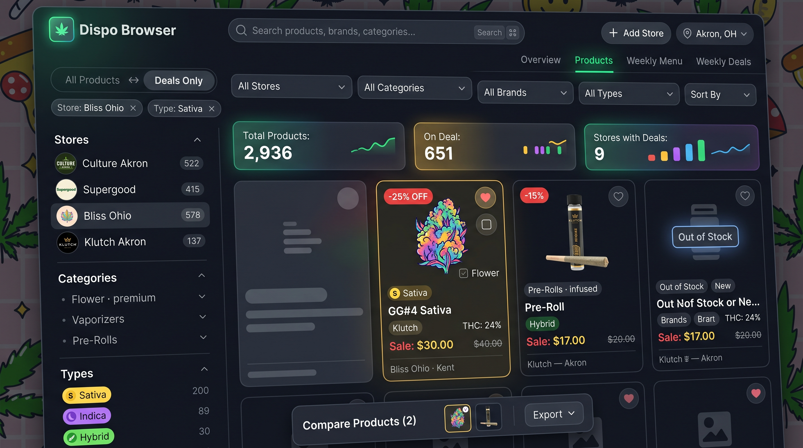

# dispo-deals



A self-hosted **multi-store dispensary deals dashboard** — the dashboard of a CEO who runs several dispensaries, except instead of tracking sales it tracks **which products at which store are discounted right now**, across the whole portfolio, from one screen.

> **Professional, but also fun and modern.**

---

## Overview

**dispo-deals** monitors dispensary menus on a configurable schedule (default every 6 hours), detects genuine discounts, sends rich Discord/Slack webhook alerts, and provides a cross-store browser with filtering, charts, and weekly menu tracking.

### Three parts in one codebase

| Piece | What it does |
|-------|--------------|
| **Scraper** (`main.py`) | Fetches every store's menu on a schedule, persists deals and weekly snapshots to SQLite |
| **Notifier** (`notifier/`) | Sends rich Discord/Slack webhooks for new deals, weekly digests, per-product alerts |
| **Dashboard** (`dashboard.html` + `api_server.py`) | Cross-store catalogue with filtering, Deal Insights charts, store management, URL state persistence |

---

## Dashboard Features

- **Full cross-shop browser**: Stores / Categories / Brands sidebar with live product counts
- **Composable filters**: Store + Category (group + subcategory) + Brand + Strain Type + Deals Only + Stock + Search + Sort — all apply together, each removable
- **Deal Insights**: Two bar charts ranking categories and brands by most deals, best average discount, or deepest single discount — re-ranked over active filters
- **Quick View modal**: Image navigation, product details, strain badges
- **Compare panel**: Up to 4 products side-by-side with export/share
- **Weekly Menu page**: This week's products per store in a printed-menu style
- **Weekly Deals page**: Deepest discount per category across the whole catalogue
- **Landing page**: Portfolio tiles per store showing product count, deal count, deepest discount
- **URL state persistence**: Every filter, search, and view survives reloads and is shareable
- **Dark theme**: Glass panels over a tiled background, reduced-motion support, self-hosted Chart.js (no internet required)

---

## Tracked Sources

| Store | Type | Scraper | Status |
|-------|------|---------|--------|
| Culture Cannabis Club — Akron | Dispensary | Dutchie | ✅ |
| Supergood — Ravenna | Dispensary | Dutchie | ✅ |
| Bliss Ohio — Kent | Dispensary | Dutchie | ✅ |
| Klutch Cannabis — Akron | Dispensary | Dutchie | ✅ |
| Klutch Cannabis — Canton | Dispensary | Dutchie | ✅ |
| Klutch Cannabis — Columbus | Dispensary | Dutchie | ✅ |
| Klutch Cannabis — Grandview | Dispensary | Dutchie | ✅ |
| Klutch Cannabis — Cleveland | Dispensary | Dutchie | ✅ |
| High Intentions | Glass/Accessories | Shoplightspeed | ✅ |
| Puffco | Vaporizers | Shopify | ✅ |
| CannaStyle | Accessories | Shopify | ✅ |
| MJ Arsenal | Accessories | Shopify | ✅ |
| DeMatteo Art | Glass/Art | Shopify | ✅ |

---

## Quick Start (Docker)

```bash
cp .env.example .env        # add your Discord/Slack webhook URL
docker compose up -d
# open http://localhost:4040/dashboard.html
docker compose logs -f scraper
```

| Service | Port | Description |
|---------|------|-------------|
| `api` | 4040 | Dashboard + API |
| `scraper` | — | Background scheduler, runs every 6h |
| `flaresolverr` | 8191 | Cloudflare bypass for Dutchie |

---

## Local Development (No Docker)

```bash
pip install -r requirements.txt
export WEBHOOK_URL="https://discord.com/api/webhooks/..."
python main.py --once --dry-run
python api_server.py
```

### Commands

```bash
python main.py --once                        # one scrape run
python main.py --import-strains              # backfill strains
python main.py --enrich-strains              # full strain profiles
python main.py --strain-status               # coverage report
python main.py --test-webhook                # send a test payload
docker compose run --rm manual-scrape
```

---

## Dashboard API

| Route | Purpose |
|-------|---------|
| `GET /api/data` | Dashboard payload (deals, weekly diff) |
| `GET /api/menu` | Full menu from latest snapshots, plus stores/categories/brands |
| `POST /api/stores/add` | Resolve + scrape + persist a store by Dutchie URL |
| `DELETE /api/stores/<id>` | Remove a runtime-added store and its data |
| `GET /api/image/<url_hash>` | Product image via the local proxy |
| `GET /api/logo/<store_id>` | Store logo via the local proxy |

---

## Architecture

```
dispo-deals/
├── config.yaml            # stores, schedule, webhook, leafly, images
├── main.py                # CLI entry point + scheduler
├── api_server.py          # dashboard API (ThreadingHTTPServer, port 4040)
├── dashboard.html         # the whole dashboard, inline CSS + JS
├── models.py              # Deal, Strain, WeeklySnapshot, SeenDeal, MenuItem, Diff
├── config.py              # typed config loading
├── scrapers/
│   ├── base.py            # BaseScraper (session, retries, headers)
│   ├── dutchie.py         # Dutchie GraphQL
│   ├── klutch.py          # Shopify-style HTML scraper
│   ├── shopify.py         # Shopify products.json scraper
│   ├── shoplightspeed.py  # Shoplightspeed collection page scraper
│   └── __init__.py        # create_scraper()
├── storage/sqlite.py      # SQLiteStorage (WAL mode)
├── notifier/webhook.py    # Discord/Slack payload builder
├── utils/
│   ├── brands.py          # canonical brand names
│   ├── categories.py      # canonical category names
│   ├── diff.py            # weekly menu comparison
│   ├── images.py          # download, cache, resize
│   ├── strain_match.py    # name → Leafly strain resolution
│   └── signal.py          # JWT/Atom feed helpers
├── vendor/chart.umd.min.js # self-hosted Chart.js
└── tests/                 # pytest test suite
```

### Data Models

```python
Deal      # store_id, product_id, name, category, original_price, sale_price,
          # discount_pct, max_discount_pct, image_url, product_url, in_stock,
          # thc_pct, cbd_pct, weight, brand, strain_name (excluded from hash)
          # hash = store_id + product_id + sale_price + discount_pct

Strain    # name, slug, leafly_id, category (Sativa/Indica/Hybrid),
          # thc_low/pct/high, cbd_low/pct/high, effects, flavors, terpenes,
          # helps_with, rating, review_count, description, image_url,
          # parents, children, source, fetched_at, lookup_count

WeeklySnapshot   # store_id, week_start (Monday), items: List[Deal]
SeenDeal         # hash, store_id, strain_name, first_seen, last_notified,
                 # notify_count, max_discount_pct
MenuItem         # deal + status (NEW / CARRYOVER)
```

### Database Tables

`seen_deals` · `weekly_snapshots` · `weekly_summaries` (once-per-week digest claims) · `known_stores` (stores added at runtime via Add Store) · `store_logos` · `product_images` · `strains` · `strain_misses`

---

## Extensibility

A new store source = a `BaseScraper` subclass registered in `scrapers/__init__.py:create_scraper()`:

```python
class BaseScraper(ABC):
    @abstractmethod
    def fetch_menu(self) -> List[Deal]: ...
    @abstractmethod
    def fetch_logo(self) -> Optional[bytes]: ...
```

Plus a `config.yaml` entry. Stores added from the dashboard at runtime go to `known_stores` and need no config edit.

---

## Notifier Spec

- **Deal detection**: Scrape on schedule, extract name/price/discount/category/image/URL, deduplicate on `store_id + product_id + sale_price + discount_pct`, re-notify only on deeper discounts
- **Rich webhooks**: Per-store (logo + deal list) and per-product (image + details + link) formats, images cached and resized
- **Weekly menu tracking**: Full snapshot per store every week, diff against previous week (NEW/CARRYOVER markers), once-per-week digest with atomic week claims

---

## Configuration (`config.yaml`)

Stores carry: `id`, `name`, `url`, `scraper`, `logo_url`, `notification_mode` (`per-store` / `per-product`), `enabled`, `webhook_enabled`.

Leafly strain matching is limited to categories that can plausibly carry a strain — edibles, topicals and tinctures are excluded because their names are flavours, not strains.

---

## Security & Reliability

- CSP, HSTS, `X-Content-Type-Options`, `X-Frame-Options`, `Referrer-Policy`, `Permissions-Policy` on every response
- Non-root container user (`appuser`)
- WAL mode SQLite for concurrency
- Graceful SIGTERM/SIGINT shutdown
- Path traversal protection on image/logo endpoints
- Scraper failures are logged and other stores continue
- Webhook failures retry with exponential backoff
- Missing images serve a local SVG placeholder
- Strain lookups are non-fatal
- API errors returned as JSON

---

## Testing

```bash
pytest                          # full suite
pytest tests/test_categories.py # category canonicalisation
pytest tests/test_strains.py    # strain matching
pytest tests/test_models.py     # data models
```

---

## License

MIT — see [LICENSE](LICENSE) for details.

---

## Contributing

PRs welcome. Please:
- Match existing code style (see `AGENTS.md` in `.kilo/`)
- Run tests and lint before submitting
- Never push or commit unless explicitly asked
- Extend rather than rewrite; reliability before cleverness

---

*Built for self-hosted environments. The tiling background image stays.*